<!-- Generated from profile/profile.yaml by pnpm generate. Edit the data, not this file. -->

<picture>
  <source media="(prefers-color-scheme: dark)" srcset="assets/generated/banner-dark.svg">
  
</picture>

<b>I build the whole product, one reliable backend and every client on top of it.</b>

7+ years in production · Remote, UTC+4 · Open to full-time roles and freelance projects

<a href="https://t.me/MrV1be">Telegram</a> · <a href="https://github.com/Mr-V1be/Mr-V1be/releases/latest/download/Evgeniy_Gospodarik_CV.pdf">CV</a> · <a href="https://github.com/Mr-V1be/Mr-V1be/releases/latest/download/Evgeniy_Gospodarik_CV_RU.pdf">Резюме</a>

## What I build

<picture>
  <source media="(prefers-color-scheme: dark)" srcset="assets/generated/showcase-dark.svg">
  
</picture>

- **Web apps**
  - [**Kedrovnik**](https://github.com/Mr-V1be/kedrovnik), house builder site with a real-time 3D configurator, estimates in the visitor's currency and a CMS · [Live demo](https://kedrovnik.46-62-170-144.sslip.io/en) Next.js · Payload CMS · React Three Fiber · PostgreSQL
  - **Gem Finder**, Telegram gift market analytics with scans below the floor, heatmaps and presets · [Live demo](https://gemfinder.46-62-170-144.sslip.io) · <i>private code</i> React · Tailwind CSS · Node.js · Express
- **Telegram bots and Mini Apps**
  - **Spotmatch**, Mini App for dating and meeting people nearby, with geo search, likes and chats · <i>private code</i> React · FastAPI · PostgreSQL · PostGIS
  - [**Mestechko**](https://github.com/Mr-V1be/mestechko), online booking with a Mini App, a bot, a business cabinet and a site widget · [Live demo](https://mestechko.tehniki.tech) NestJS · React · grammY · PostgreSQL
- **Backend and AI**
  - [**Snoska**](https://github.com/Mr-V1be/snoska), B2B document compliance checks with retrieval, AI fixes and audit trails · [Live demo](https://snoska.tehniki.tech) FastAPI · Next.js · Keycloak · pgvector
- **iOS and Android**
  - booking client and staff apps with offline sync, encrypted storage and store releases · <i>client work under NDA</i> React Native · Expo · SQLCipher
- **E-commerce**
  - a Shopify app, a WooCommerce plugin and a multi-seller Laravel marketplace · <i>client work under NDA</i> Shopify · WooCommerce · Laravel
- **Desktop**
  - file processing and sync for Windows, macOS and Linux with signed auto-updates · <i>client work under NDA</i> Electron · SQLite · electron-builder
- **Graphics and simulation**
  - [**Flux Sandbox**](https://github.com/Mr-V1be/flux-sandbox), falling-sand cellular automaton with a thermal field and 54 reactive materials · [Live demo](https://mr-v1be.github.io/flux-sandbox/) TypeScript · Canvas · Vite

## How I work

- **Architecture first:** clear domain boundaries, registries instead of hardcode, one source of truth.
- **Correct where money moves:** transactions, idempotent operations and reconciliation for payments, bookings and stock.
- **Tested and observable:** contract tests on critical paths, CI on every push, structured logs and error tracking.
- **Shipped, not just written:** Docker, CI/CD, backups and a runbook for every project I hand over.

## Activity

<picture>
  <source media="(prefers-color-scheme: dark)" srcset="https://raw.githubusercontent.com/Mr-V1be/Mr-V1be/output/live/activity-dark.svg">
  
</picture>

## Open source

- [floze-the-genius/opencode-multi-auth-codex](https://github.com/floze-the-genius/opencode-multi-auth-codex) ★190 · 5 merged pull requests, a local auth dashboard and usage-based rate limits
